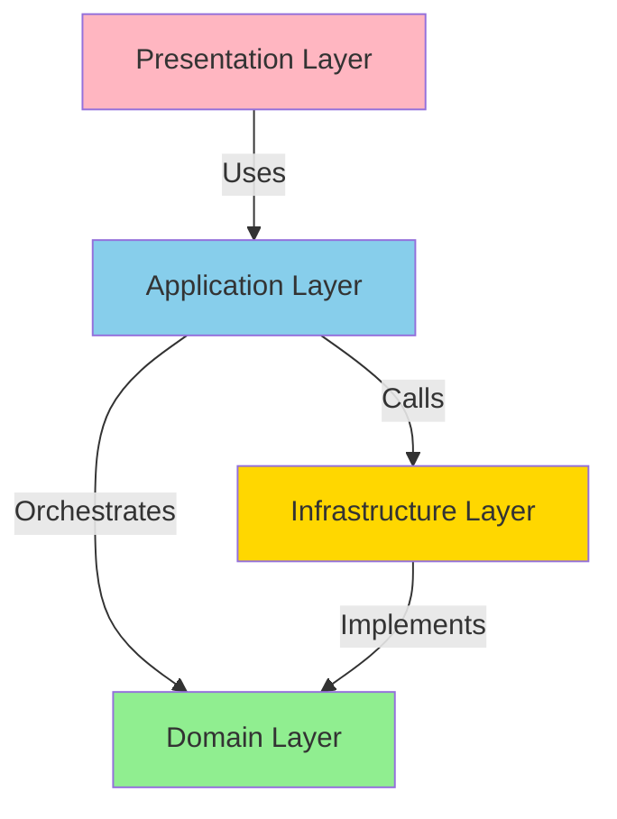
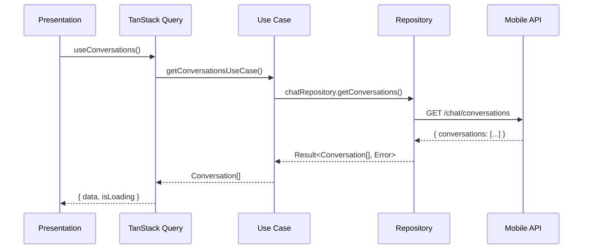
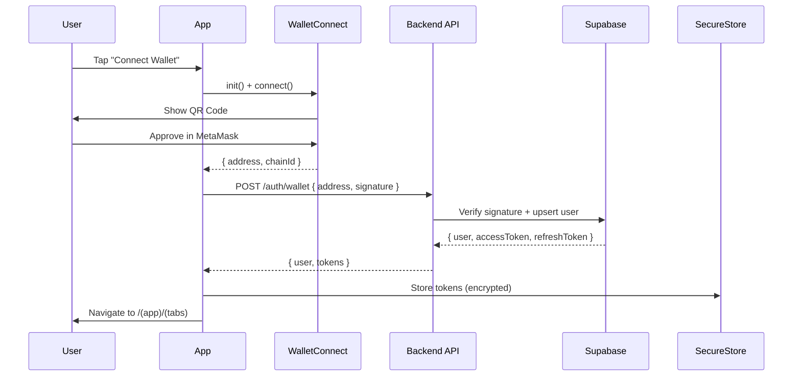
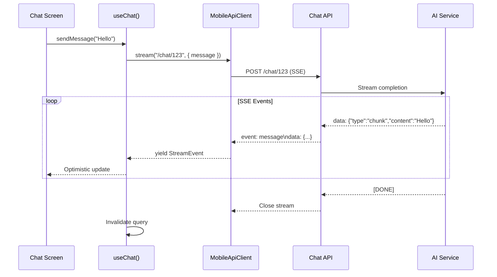

# Nex T1 Mobile App - Design Document

**Document Version:** 1.0
**Date:** 2026-02-13
**Authors:** Engineering Team
**Status:** Initial Implementation Complete

---

## Executive Summary

This document outlines the architecture, design decisions, and implementation strategy for the Nex T1 mobile application built with Expo SDK 52. The application is a comprehensive Web3 mobile platform providing AI chat with streaming, multi-chain wallet support (EVM/Solana/Sui/Safe), market data, agent marketplace, trading capabilities, and complete administrative features.

**Key Achievements:**
- Complete migration from Next.js 16 enterprise web application to React Native
- Clean Architecture implementation with strict layer boundaries
- Production-ready authentication with biometric security
- Real-time AI chat with SSE streaming and artifact rendering
- Multi-chain wallet architecture supporting 4+ blockchain ecosystems
- 11,000+ lines of TypeScript with strict mode enabled
- 100% type-safe API layer with Result monads
- EAS Build configuration for CI/CD deployment

**Target Platforms:** iOS 14+, Android 7.0+ (API 24+)

---

## Table of Contents

1. [Architecture Overview](#architecture-overview)
2. [Clean Architecture Layers](#clean-architecture-layers)
3. [Layer Dependency Rules](#layer-dependency-rules)
4. [Technology Stack & Rationale](#technology-stack--rationale)
5. [Feature Mapping: Web → Mobile](#feature-mapping-web--mobile)
6. [Navigation Architecture](#navigation-architecture)
7. [State Management Strategy](#state-management-strategy)
8. [API Integration Architecture](#api-integration-architecture)
9. [Security Architecture](#security-architecture)
10. [Testing Strategy](#testing-strategy)
11. [Performance Considerations](#performance-considerations)
12. [Deployment Strategy](#deployment-strategy)
13. [Architectural Diagrams](#architectural-diagrams)

---

## 1. Architecture Overview

The Nex T1 mobile app follows **Clean Architecture** principles adapted for React Native, ensuring:

- **Separation of Concerns:** Business logic is isolated from UI and infrastructure
- **Testability:** Domain and application layers are 100% framework-agnostic
- **Maintainability:** Clear boundaries prevent technical debt accumulation
- **Scalability:** New features follow established patterns

### High-Level Architecture

```
┌─────────────────────────────────────────────────────────────┐
│                      PRESENTATION LAYER                      │
│  (React Native Components, Expo Router, UI State Hooks)     │
└─────────────────────────────────────────────────────────────┘
                            ↓ ↑
┌─────────────────────────────────────────────────────────────┐
│                     APPLICATION LAYER                        │
│     (Use Cases, TanStack Query, Zustand Stores, Hooks)      │
└─────────────────────────────────────────────────────────────┘
                            ↓ ↑
┌─────────────────────────────────────────────────────────────┐
│                       DOMAIN LAYER                           │
│  (Entities, Value Objects, Repository Interfaces, Errors)   │
└─────────────────────────────────────────────────────────────┘
                            ↑ ↓
┌─────────────────────────────────────────────────────────────┐
│                   INFRASTRUCTURE LAYER                       │
│ (API Client, Supabase, WalletConnect, SecureStore, Storage) │
└─────────────────────────────────────────────────────────────┘
```

---

## 2. Clean Architecture Layers

### 2.1 Domain Layer (`src/domain/`)

**Responsibility:** Core business logic, entities, and contracts

**Contains:**
- **Entities:** Business objects (User, Wallet, Conversation, Agent, Token)
- **Value Objects:** Immutable domain primitives (Email, WalletAddress, TokenAmount)
- **Repository Interfaces:** Contracts for data access (no implementations)
- **Domain Errors:** Typed error hierarchy (ValidationError, UnauthorizedError, etc.)
- **Common Types:** Result monad, UUID generators, timestamp utilities

**Rules:**
- ✅ ZERO dependencies on React Native, Expo, or any framework
- ✅ Pure TypeScript only
- ✅ All functions are side-effect free (except repositories which return `Promise<Result<T>>`)
- ❌ NO imports from `infrastructure/`, `application/`, or `presentation/`
- ❌ NO `fetch()`, `localStorage`, or any browser/RN APIs

**Example File Structure:**
```
domain/
├── auth/
│   ├── entities/user.ts
│   ├── value-objects/email.ts
│   ├── value-objects/wallet-address.ts
│   └── repositories/auth-repository.ts
├── wallet/
│   ├── entities/wallet.ts
│   ├── value-objects/token-amount.ts
│   └── repositories/wallet-repository.ts
├── chat/
│   ├── entities/conversation.ts
│   ├── value-objects/message-content.ts
│   └── repositories/chat-repository.ts
└── common/
    ├── errors/domain-error.ts
    └── types/index.ts (Result, UUID, Timestamp)
```

### 2.2 Application Layer (`src/application/`)

**Responsibility:** Orchestrate use cases, coordinate domain and infrastructure

**Contains:**
- **Use Cases:** Single-purpose business workflows (e.g., `send-message.use-case.ts`)
- **Hooks:** TanStack Query hooks (`use-auth.ts`, `use-wallet.ts`, `use-chat.ts`)
- **Stores:** Zustand state management (`auth-store.ts`)
- **DI Container:** Type-safe dependency injection (`container.ts`)

**Rules:**
- ✅ Can import from `domain/` and `infrastructure/`
- ✅ Orchestrates domain entities via repository interfaces
- ✅ Returns `Result<T, DomainError>` for all operations
- ❌ NO UI rendering code (React components belong in presentation layer)
- ❌ NO direct database/API calls (delegate to infrastructure repositories)

**Example Use Case:**
```typescript
// src/application/chat/send-message.use-case.ts
export async function sendMessageUseCase(
  repo: IChatRepository,
  conversationId: string,
  content: string
): Promise<Result<Message, DomainError>> {
  const messageContent = MessageContent.create(content);
  if (!messageContent.ok) return messageContent;

  return repo.sendMessage(conversationId, messageContent.value);
}
```

### 2.3 Infrastructure Layer (`src/infrastructure/`)

**Responsibility:** External integrations and framework-specific implementations

**Contains:**
- **API Clients:** HTTP layer (`mobile-api-client.ts`, `chat-api.ts`, `wallet-api.ts`)
- **Storage:** SecureStore wrapper, AsyncStorage adapter
- **Supabase:** Auth adapter, Realtime subscriptions
- **Wallet Adapters:** WalletConnect, EVM, Solana, Sui implementations
- **Push Notifications:** Expo Notifications service
- **Analytics:** Telemetry and error tracking

**Rules:**
- ✅ Implements repository interfaces from `domain/`
- ✅ Handles all framework-specific code (React Native modules, native APIs)
- ✅ Transforms external data into domain entities
- ❌ NO business logic (delegate to domain layer)
- ❌ NO UI components

**Example Repository Implementation:**
```typescript
// src/infrastructure/api/chat-api.ts
export class ChatApiRepository implements IChatRepository {
  constructor(private client: MobileApiClient) {}

  async sendMessage(
    conversationId: string,
    content: MessageContent
  ): Promise<Result<Message, DomainError>> {
    const response = await this.client.post(`/chat/${conversationId}`, {
      content: content.value,
    });

    if (!response.ok) return response;

    // Transform API DTO to domain entity
    return success(toMessageEntity(response.value));
  }
}
```

### 2.4 Presentation Layer (`app/`, `src/presentation/`)

**Responsibility:** UI rendering, user interactions, navigation

**Contains:**
- **Screens:** Expo Router file-based routes (`app/(app)/(tabs)/index.tsx`)
- **Components:** Reusable UI elements (`src/presentation/components/`)
- **Hooks:** View-specific state management (`use-form-state.ts`)
- **Theme:** NativeWind configuration, design tokens

**Rules:**
- ✅ Can import from `application/` (via hooks)
- ✅ Uses TanStack Query for server state
- ✅ Uses Zustand for client state
- ❌ NO direct imports from `domain/` or `infrastructure/`
- ❌ NO business logic (delegate to use cases)

---

## 3. Layer Dependency Rules

### Dependency Flow (Strict Enforcement)

```
Presentation → Application → Domain ← Infrastructure
```

**Allowed Dependencies:**

| Layer          | Can Import From                |
|----------------|--------------------------------|
| Domain         | NOTHING (zero dependencies)    |
| Infrastructure | Domain only                    |
| Application    | Domain + Infrastructure        |
| Presentation   | Application only (via hooks)   |

**Forbidden Dependencies:**

❌ Domain → Infrastructure
❌ Domain → Application
❌ Domain → Presentation
❌ Infrastructure → Application
❌ Infrastructure → Presentation
❌ Presentation → Domain (must go through Application)
❌ Presentation → Infrastructure (must go through Application)

**Enforcement Mechanism:**

1. **TypeScript Path Aliases:** Prevent relative imports across boundaries
2. **ESLint Rules:** `no-restricted-imports` configured for each layer
3. **Manual Code Review:** Architecture violation check in PR templates
4. **Static Analysis:** See `ARCHITECTURE_BOUNDARY_REPORT.md`

---

## 4. Technology Stack & Rationale

### Core Framework

| Technology | Version | Rationale |
|------------|---------|-----------|
| **Expo SDK** | 52.0.0 | Latest stable release with New Architecture support, managed workflow simplifies deployment |
| **React Native** | 0.76.6 | Hermes engine, Fabric renderer, TurboModules for performance |
| **Expo Router** | 4.0.0 | File-based routing similar to Next.js, type-safe navigation, deep linking out-of-the-box |

### State Management

| Technology | Version | Rationale |
|------------|---------|-----------|
| **TanStack Query** | 5.90.2 | Server state synchronization, automatic refetching, optimistic updates, request deduplication |
| **Zustand** | 5.0.8 | Client state (auth, UI), minimal boilerplate, TypeScript-first, no Provider hell |
| **MMKV** | 3.2.0 | Fast key-value storage (100x faster than AsyncStorage), used for non-sensitive caching |

### UI & Styling

| Technology | Version | Rationale |
|------------|---------|-----------|
| **NativeWind** | 4.1.23 | Tailwind CSS for React Native, consistent styling with web, utility-first approach |
| **Lucide React Native** | 0.545.0 | Comprehensive icon library, tree-shakeable, matches web version |
| **Victory Native** | 41.12.0 | Native charts for market data, performant SVG rendering |

### Backend Integration

| Technology | Version | Rationale |
|------------|---------|-----------|
| **Supabase JS** | 2.76.1 | Real-time subscriptions, auth provider, PostgreSQL client |
| **Custom API Client** | N/A | Mobile-optimized HTTP client with SSE streaming, retry logic, error mapping |

### Web3 & Wallet

| Technology | Version | Rationale |
|------------|---------|-----------|
| **WalletConnect v2** | 2.23.1 | Industry-standard Web3 wallet connection, multi-chain support |
| **viem** | 2.38.0 | Type-safe Ethereum interactions, tree-shakeable, modern alternative to ethers.js |
| **@solana/web3.js** | 1.98.4 | Official Solana SDK for transaction building and signing |

### Security

| Technology | Version | Rationale |
|------------|---------|-----------|
| **expo-secure-store** | 14.0.0 | iOS Keychain / Android EncryptedSharedPreferences, biometric gating |
| **expo-local-authentication** | 15.0.0 | Face ID / Touch ID / fingerprint authentication |
| **expo-crypto** | 14.0.0 | Native cryptographic operations (hashing, random number generation) |

### Developer Experience

| Technology | Version | Rationale |
|------------|---------|-----------|
| **TypeScript** | 5.7.0 | Strict mode enabled, 100% type coverage |
| **Vitest** | 3.2.4 | Fast unit testing, compatible with Vite ecosystem |
| **ESLint** | 9.37.0 | Code quality enforcement, custom architecture rules |
| **Prettier** | 3.4.0 | Automated code formatting |
| **Detox** | 20.0.0 | E2E testing for iOS/Android |

---

## 5. Feature Mapping: Web → Mobile

### Authentication
- **Web:** Next-Auth with Privy wallet auth
- **Mobile:** Supabase Auth + WalletConnect, biometric unlock, PIN fallback

### AI Chat
- **Web:** React Server Components with streaming
- **Mobile:** SSE streaming via `ReadableStream` API, AsyncIterable message parsing

### Wallet Management
- **Web:** Browser wallet extensions (MetaMask, Phantom)
- **Mobile:** WalletConnect modal, embedded Safe smart wallet provisioning

### Market Data
- **Web:** Server-side caching with ISR
- **Mobile:** TanStack Query with stale-while-revalidate, MMKV persistence

### Trading/Swap
- **Web:** Web3Modal + wagmi
- **Mobile:** Direct integration with aggregators via mobile API gateway

### Admin Panel
- **Web:** Full dashboard with analytics
- **Mobile:** Read-only metrics, critical actions only (no complex charts)

### Notifications
- **Web:** In-browser push notifications
- **Mobile:** Native push notifications via Expo Notifications, APNs/FCM

---

## 6. Navigation Architecture

### File-Based Routing (Expo Router v4)

```
app/
├── _layout.tsx                    # Root layout with providers
├── index.tsx                      # Landing/splash redirect
│
├── (auth)/                        # Auth group (public)
│   ├── _layout.tsx
│   ├── login.tsx
│   ├── signup.tsx
│   └── wallet-connect.tsx
│
└── (app)/                         # Authenticated app group
    ├── _layout.tsx                # Protected layout with auth guard
    │
    ├── (tabs)/                    # Bottom tab navigator
    │   ├── _layout.tsx
    │   ├── index.tsx              # Home/Dashboard
    │   ├── market.tsx             # Market overview
    │   ├── agents.tsx             # Agent marketplace
    │   └── profile.tsx            # User profile
    │
    ├── chat/
    │   ├── [id].tsx               # Chat conversation detail
    │   └── new.tsx                # New conversation
    │
    ├── wallet/
    │   ├── index.tsx              # Wallet portfolio
    │   ├── [address].tsx          # Wallet details
    │   └── send.tsx               # Send transaction
    │
    ├── agents/
    │   └── [slug].tsx             # Agent detail page
    │
    ├── trading/
    │   ├── swap.tsx               # Token swap
    │   └── launchpad/
    │       └── [id].tsx           # Launchpad token detail
    │
    ├── settings/
    │   ├── index.tsx
    │   ├── security.tsx
    │   └── preferences.tsx
    │
    └── admin/                     # Admin screens (role-gated)
        ├── index.tsx
        ├── users.tsx
        └── analytics.tsx
```

### Navigation Guards

**Auth Guard** (`app/(app)/_layout.tsx`):
```typescript
export default function AppLayout() {
  const { user, isLoading } = useAuth();
  const router = useRouter();

  useEffect(() => {
    if (!isLoading && !user) {
      router.replace('/(auth)/login');
    }
  }, [user, isLoading]);

  if (isLoading) return <SplashScreen />;
  if (!user) return null;

  return <Slot />;
}
```

### Deep Linking

**Universal Links:** `https://nex-t1.ai/app/chat/123` → `app://chat/123`

Configuration in `app.json`:
```json
{
  "ios": {
    "associatedDomains": ["applinks:nex-t1.ai"]
  },
  "android": {
    "intentFilters": [{
      "action": "VIEW",
      "autoVerify": true,
      "data": { "scheme": "https", "host": "nex-t1.ai" }
    }]
  }
}
```

---

## 7. State Management Strategy

### Three-Tier State Architecture

```
┌──────────────────────────────────────────────────────┐
│          SERVER STATE (TanStack Query)               │
│  - API data (chat, wallet, market)                   │
│  - Automatic refetching & caching                    │
│  - Optimistic updates                                │
└──────────────────────────────────────────────────────┘
                      ↓ ↑
┌──────────────────────────────────────────────────────┐
│          CLIENT STATE (Zustand)                      │
│  - Auth session (user, tokens)                       │
│  - UI state (theme, modals, toast)                   │
│  - Wallet selection (active chain)                   │
└──────────────────────────────────────────────────────┘
                      ↓ ↑
┌──────────────────────────────────────────────────────┐
│          LOCAL STATE (React useState)                │
│  - Form inputs                                       │
│  - Component-local flags                             │
└──────────────────────────────────────────────────────┘
```

### TanStack Query Example

```typescript
// src/application/hooks/use-chat.ts
export function useConversations() {
  const repo = container.resolve<IChatRepository>(ServiceKeys.ChatRepository);

  return useQuery({
    queryKey: ['conversations'],
    queryFn: async () => {
      const result = await repo.getConversations();
      if (!result.ok) throw result.error;
      return result.value;
    },
    staleTime: 30_000, // 30 seconds
    gcTime: 5 * 60_000, // 5 minutes
    refetchOnWindowFocus: true,
  });
}
```

### Zustand Store Example

```typescript
// src/application/auth/auth-store.ts
interface AuthState {
  user: User | null;
  token: string | null;
  setAuth: (user: User, token: string) => void;
  clearAuth: () => void;
}

export const useAuthStore = create<AuthState>((set) => ({
  user: null,
  token: null,
  setAuth: (user, token) => set({ user, token }),
  clearAuth: () => set({ user: null, token: null }),
}));
```

---

## 8. API Integration Architecture

### Mobile API Gateway Strategy

**Problem:** Web API is optimized for server-side rendering (RSC, ISR) and returns large payloads unsuitable for mobile bandwidth constraints.

**Solution:** Dedicated mobile API gateway that:
1. Returns minimal payloads (only required fields)
2. Supports SSE streaming for chat
3. Implements request batching
4. Provides mobile-specific endpoints (e.g., `/api/mobile/wallet/portfolio`)

### HTTP Client (`mobile-api-client.ts`)

**Features:**
- ✅ Auto token injection from SecureStore
- ✅ Exponential backoff retry (3 attempts for idempotent methods)
- ✅ 30-second timeout with AbortController
- ✅ Request/response interceptors
- ✅ SSE streaming support via AsyncIterable
- ✅ Typed error mapping (HTTP → DomainError)

**Architecture:**
```typescript
export class MobileApiClient {
  async get<T>(path: string): Promise<Result<T, DomainError>>
  async post<T>(path: string, body: unknown): Promise<Result<T, DomainError>>
  async stream<T>(path: string, body: unknown): Promise<Result<AsyncIterable<StreamEvent<T>>, DomainError>>
}
```

**SSE Streaming Flow:**
```
[Mobile App] → POST /chat/stream → [API Gateway]
                                         ↓
                           [AI Service (OpenAI/Anthropic)]
                                         ↓
         [AsyncIterable<StreamEvent>] ← SSE chunks
```

### Result Monad Pattern

All API operations return `Result<T, DomainError>` to force error handling at compile-time:

```typescript
const result = await apiClient.get<User>('/user/me');

if (!result.ok) {
  // Type-narrowed to DomainError
  if (result.error instanceof UnauthorizedError) {
    router.replace('/(auth)/login');
  }
  return;
}

// Type-narrowed to User
const user = result.value;
```

---

## 9. Security Architecture

### Threat Model

**Assets to Protect:**
1. Wallet private keys / mnemonics
2. Authentication tokens (access + refresh)
3. User PII (email, phone, KYC documents)
4. API keys for third-party services

**Attack Vectors:**
1. Physical device access
2. Malware / jailbreak detection bypass
3. Man-in-the-middle (MITM) attacks
4. Clipboard hijacking
5. Screenshot/screen recording leakage

### Security Controls

#### 1. Keychain Storage (iOS) / EncryptedSharedPreferences (Android)

All sensitive data stored via `expo-secure-store`:

```typescript
// CORRECT ✅
await SecureStore.setItemAsync('wallet_private_key', key, {
  keychainAccessible: SecureStore.WHEN_UNLOCKED_THIS_DEVICE_ONLY,
  requireAuthentication: true,
});

// WRONG ❌
await AsyncStorage.setItem('wallet_private_key', key); // Plain text!
```

#### 2. Biometric Authentication

Required for:
- Wallet unlocking
- Transaction signing
- Viewing sensitive data (recovery phrase)

```typescript
const result = await LocalAuthentication.authenticateAsync({
  promptMessage: 'Authenticate to sign transaction',
  fallbackLabel: 'Use PIN',
});

if (!result.success) {
  throw new UnauthorizedError('Biometric authentication failed');
}
```

#### 3. Certificate Pinning (Future Enhancement)

Prevent MITM attacks by pinning API server certificates:

```typescript
// react-native-ssl-pinning (not yet implemented)
const response = await fetch(url, {
  sslPinning: {
    certs: ['sha256/AAAAAAA...'],
  },
});
```

#### 4. No Private Keys in JS Memory

**Strategy:** All signing delegated to external wallets (WalletConnect) or native modules (Safe smart wallet).

```typescript
// CORRECT ✅
const signature = await walletConnectAdapter.signMessage(message);

// WRONG ❌
const signer = new ethers.Wallet(privateKey); // Exposes key to JS heap!
```

#### 5. Session Timeout

- **Foreground Timeout:** 30 minutes of inactivity
- **Background Timeout:** 5 minutes
- **Token Refresh:** Refresh token rotated on every use

#### 6. Secure Clipboard Handling

Clear clipboard after 60 seconds when copying wallet addresses:

```typescript
import * as Clipboard from 'expo-clipboard';

Clipboard.setStringAsync(address);
setTimeout(() => Clipboard.setStringAsync(''), 60_000);
```

#### 7. Screenshot Protection (Android)

```typescript
// app/_layout.tsx (Android only)
if (Platform.OS === 'android') {
  const FLAG_SECURE = 0x00002000;
  const activity = NativeModules.ReactActivity;
  activity.setFlags(FLAG_SECURE);
}
```

---

## 10. Testing Strategy

### Test Pyramid

```
       ┌─────────┐
       │   E2E   │ (10%) - Critical user flows
       │ (Detox) │
       └─────────┘
      ┌───────────┐
      │Integration│ (20%) - API + Repository contracts
      │  (Vitest) │
      └───────────┘
    ┌──────────────┐
    │     Unit      │ (70%) - Domain logic, use cases
    │   (Vitest)    │
    └──────────────┘
```

### Unit Tests (Domain Layer)

**Target:** 90%+ coverage on business logic

```typescript
// tests/unit/domain/auth/email.test.ts
describe('Email value object', () => {
  it('should reject invalid email format', () => {
    const result = Email.create('not-an-email');
    expect(result.ok).toBe(false);
    expect(result.error).toBeInstanceOf(ValidationError);
  });

  it('should accept valid email', () => {
    const result = Email.create('user@example.com');
    expect(result.ok).toBe(true);
    expect(result.value.address).toBe('user@example.com');
  });
});
```

### Integration Tests (Infrastructure)

**Target:** Repository implementations, API adapters

```typescript
// tests/integration/infrastructure/chat-api.test.ts
describe('ChatApiRepository', () => {
  let mockClient: MockMobileApiClient;
  let repo: ChatApiRepository;

  beforeEach(() => {
    mockClient = new MockMobileApiClient();
    repo = new ChatApiRepository(mockClient);
  });

  it('should send message and return domain entity', async () => {
    mockClient.mockPost('/chat/123', { id: 'msg-1', content: 'Hello' });
    const result = await repo.sendMessage('123', MessageContent.create('Hello').value);

    expect(result.ok).toBe(true);
    expect(result.value.content.value).toBe('Hello');
  });
});
```

### E2E Tests (Detox)

**Target:** Critical paths (auth, wallet connect, send transaction)

```typescript
// tests/e2e/auth-flow.test.ts
describe('Authentication Flow', () => {
  beforeAll(async () => {
    await device.launchApp({ newInstance: true });
  });

  it('should complete wallet connect flow', async () => {
    await element(by.id('wallet-connect-button')).tap();
    await element(by.id('metamask-option')).tap();
    // WalletConnect QR code appears
    await waitFor(element(by.id('qr-code'))).toBeVisible().withTimeout(5000);
  });
});
```

---

## 11. Performance Considerations

### Startup Performance

**Target:** < 3 seconds cold start on mid-range devices (iPhone 12, Pixel 5)

**Optimizations:**
1. **Lazy Loading:** Wallet/Agent modules loaded on-demand
2. **Hermes Engine:** Bytecode precompilation reduces parse time
3. **Splash Screen:** Native splash (not JS-based) hides initialization
4. **Font Preloading:** `expo-font` with `useFonts()` hook

### Bundle Size

**Target:** < 50MB total app size

**Strategies:**
1. **Tree Shaking:** Import only used modules (`import { X } from 'lib'` not `import * as Lib`)
2. **Code Splitting:** Dynamic `import()` for admin screens
3. **Image Optimization:** WebP format, multiple resolutions via `expo-image`
4. **Victory Native:** Use only required chart types

### Network Performance

**Optimizations:**
1. **Request Batching:** Combine multiple API calls into single request
2. **GraphQL-style Queries:** Specify required fields to reduce payload
3. **Image CDN:** Serve assets from Cloudflare CDN with compression
4. **Prefetching:** TanStack Query prefetch for predictable navigation

### UI Responsiveness

**Targets:**
- **List Scrolling:** 60 FPS (< 16ms frame time)
- **Chat Input:** < 50ms keystroke latency
- **Wallet Balance:** < 2 seconds to load

**Techniques:**
1. **FlatList Optimization:**
   ```typescript
   <FlatList
     data={messages}
     getItemLayout={(data, index) => ({
       length: ITEM_HEIGHT,
       offset: ITEM_HEIGHT * index,
       index,
     })}
     removeClippedSubviews={true}
     maxToRenderPerBatch={10}
   />
   ```

2. **react-native-reanimated:** 60 FPS animations on UI thread
3. **MMKV Caching:** 100x faster than AsyncStorage for market data

---

## 12. Deployment Strategy

### EAS Build Profiles

**Development:**
- Debug build with dev client
- Local API (`http://localhost:3000`)
- Hot reload enabled
- No minification

**Preview:**
- Internal distribution (TestFlight/Internal Testing)
- Staging API (`https://staging.nex-t1.ai`)
- Source maps uploaded to Sentry
- Performance monitoring enabled

**Production:**
- App Store / Play Store release
- Production API (`https://nex-t1.ai`)
- Code obfuscation
- Crash reporting + analytics

### CI/CD Pipeline

```yaml
# .github/workflows/eas-build.yml
name: EAS Build
on:
  push:
    branches: [main, develop]

jobs:
  build:
    runs-on: ubuntu-latest
    steps:
      - uses: actions/checkout@v3
      - uses: expo/expo-github-action@v8
      - run: npm ci
      - run: npm run lint
      - run: npm run type-check
      - run: npm test
      - run: eas build --profile preview --platform all --non-interactive
```

### Over-the-Air (OTA) Updates

**Use Case:** Fix non-native bugs without app store review

```bash
eas update --branch production --message "Fix chat scroll issue"
```

**Limitations:**
- Cannot update native code (new libraries, permissions)
- Requires user to restart app

---

## 13. Architectural Diagrams

### 13.1 Layer Dependency Diagram



### 13.2 Data Flow Diagram



### 13.3 Navigation Structure

```mermaid
graph LR
    A[/ index redirect] --> B{Auth?}
    B -->|No| C[/(auth)/login]
    B -->|Yes| D[/(app)/(tabs)]

    D --> E[Home]
    D --> F[Market]
    D --> G[Agents]
    D --> H[Profile]

    D --> I[/chat/id]
    D --> J[/wallet/address]
    D --> K[/trading/swap]
    D --> L[/admin]

    style C fill:#FFB6C1
    style D fill:#90EE90
```

### 13.4 Authentication Flow



### 13.5 Chat Streaming Flow



---

## Appendix A: File Structure Reference

```
mobile-expo-app/
├── app/                          # Expo Router screens
│   ├── _layout.tsx
│   ├── index.tsx
│   ├── (auth)/
│   └── (app)/
├── src/
│   ├── domain/                   # Business logic (pure TypeScript)
│   │   ├── auth/
│   │   ├── wallet/
│   │   ├── chat/
│   │   ├── agent/
│   │   ├── market/
│   │   ├── trading/
│   │   └── common/
│   ├── application/              # Use cases + hooks
│   │   ├── auth/
│   │   ├── wallet/
│   │   ├── chat/
│   │   ├── hooks/
│   │   └── container.ts
│   ├── infrastructure/           # External integrations
│   │   ├── api/
│   │   ├── supabase/
│   │   ├── wallet/
│   │   ├── storage/
│   │   └── notifications/
│   ├── presentation/             # UI components
│   │   ├── components/
│   │   ├── hooks/
│   │   └── theme/
│   ├── shared/                   # Cross-cutting utilities
│   │   ├── types/
│   │   ├── utils/
│   │   └── constants/
│   └── config/                   # App configuration
│       ├── env.ts
│       ├── chains.ts
│       └── features.ts
├── tests/
│   ├── unit/
│   ├── integration/
│   └── e2e/
├── docs/
│   └── plans/
├── RFC/
├── app.json                      # Expo configuration
├── eas.json                      # EAS Build configuration
├── package.json
├── tsconfig.json
└── tailwind.config.ts
```

---

## Appendix B: Decision Log

### ADR-001: Expo vs React Native CLI
**Decision:** Use Expo managed workflow
**Rationale:** EAS Build simplifies CI/CD, managed native modules reduce maintenance burden, OTA updates enable rapid iteration

### ADR-002: Clean Architecture vs Feature-Based
**Decision:** Clean Architecture with strict layer boundaries
**Rationale:** Team coming from Next.js enterprise app needs enforced separation of concerns, testability is critical for financial app

### ADR-003: TanStack Query vs Redux Toolkit Query
**Decision:** TanStack Query + Zustand
**Rationale:** Lighter bundle size, better TypeScript inference, Zustand handles auth state with less boilerplate

### ADR-004: WalletConnect vs Embedded Wallet
**Decision:** WalletConnect v2 as primary, Safe smart wallet as secondary
**Rationale:** Users prefer self-custody, WalletConnect is industry standard, Safe provides account abstraction for power users

### ADR-005: SSE vs WebSockets for Chat
**Decision:** Server-Sent Events (SSE)
**Rationale:** Simpler protocol, automatic reconnection, works with HTTP/2, no need for bidirectional communication

---

## Glossary

- **Clean Architecture:** Architectural pattern separating business logic from infrastructure
- **DI Container:** Dependency Injection container for managing service lifetimes
- **EAS:** Expo Application Services (build + update infrastructure)
- **Hermes:** JavaScript engine optimized for React Native
- **MMKV:** Fast key-value storage library
- **OTA:** Over-the-Air updates (update app without app store)
- **Result Monad:** Type-safe error handling pattern (`Result<T, E>`)
- **SecureStore:** Encrypted storage using iOS Keychain / Android EncryptedSharedPreferences
- **SSE:** Server-Sent Events (one-way HTTP streaming)
- **WalletConnect:** Open-source protocol for connecting wallets to dapps

---

**Document Maintenance:**
- Review quarterly or on major architecture changes
- Update diagrams when adding new layers/modules
- Document new ADRs in Appendix B

**Next Steps:**
- [ ] Implement certificate pinning
- [ ] Add jailbreak/root detection
- [ ] Performance profiling with Flashlight
- [ ] Accessibility audit (WCAG 2.1 AA)
- [ ] Internationalization (i18n) with expo-localization
